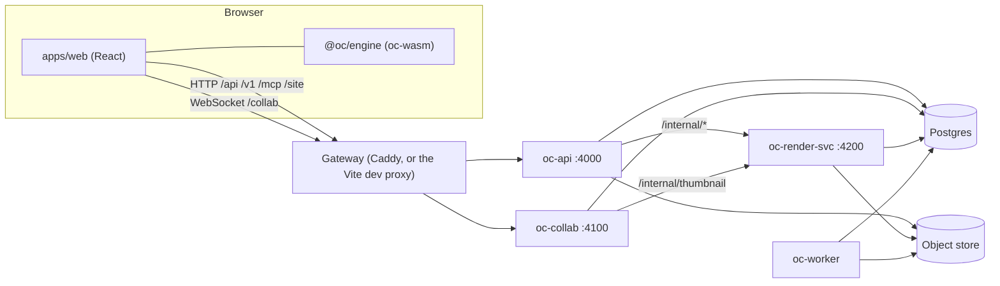
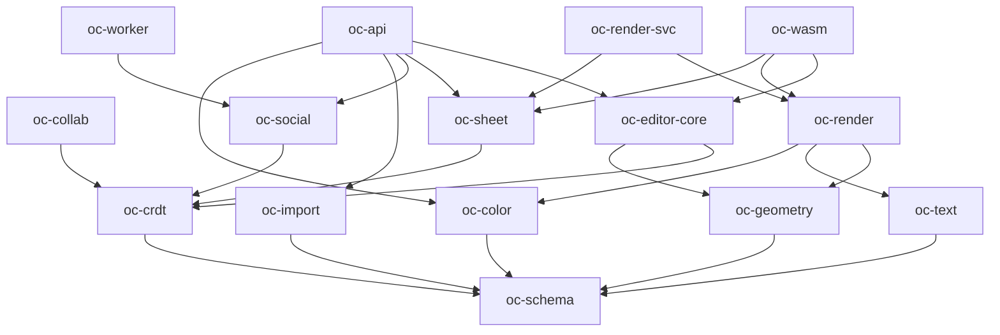
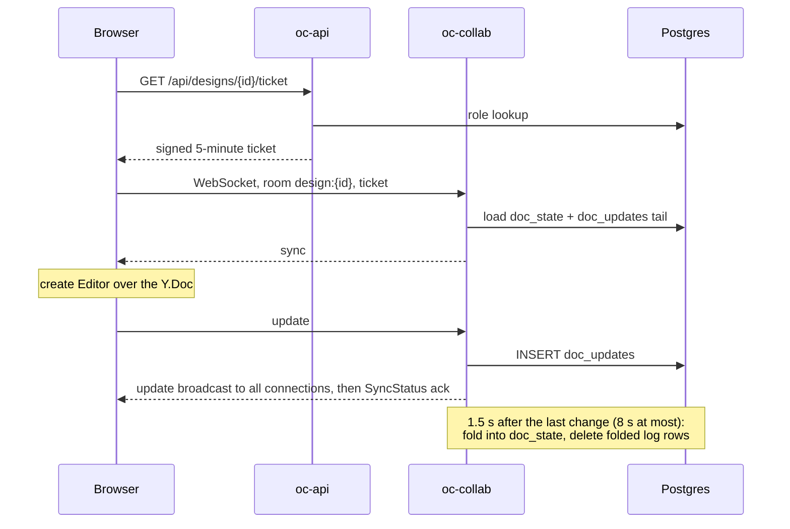

# Architecture

This document describes how Pinselo fits together as built. It is written for engineers about to change the code. To run it, see [getting-started.md](getting-started.md); to test a change, see [testing.md](testing.md).

Names you will see throughout: Rust crates start with `oc-` and TypeScript packages with `@oc/`. Code comments often refer to `services/*`, `packages/*` and `tools/golden/*.ts`. Except for `packages/engine` and `packages/config`, those paths no longer exist: they describe the TypeScript implementation the Rust code replaced. The reasoning behind the split is in [ADR-0001](adr/0001-rust-core.md).

## The system at a glance

The browser UI is React and TypeScript. Everything else is Rust: four services on the server, and the editor core, compiled to WebAssembly, in the browser.



Only the API and collab server are reachable through the gateway. See `deploy/Caddyfile` for production routing and `apps/web/vite.config.ts` for the development proxy. Both strip the `/collab` prefix before the request reaches `oc-collab`.

## Repository layout

| Path | Contents |
|---|---|
| `apps/web` | The React application (`@oc/web`) |
| `apps/mobile` | Capacitor shell for iOS and Android (`@oc/mobile`) |
| `packages/engine` | `@oc/engine`: the TypeScript facade over the WebAssembly build of `crates/oc-wasm` |
| `packages/config` | `@oc/config`: browser and Node configuration values |
| `crates/` | Every Rust crate, including `crates/oc-platform/*` |
| `crates/vendor/krilla` | Patched copy of the krilla PDF library |
| `deploy/` | Dockerfile, Compose file and Caddy configuration |
| `fixtures/` | Fonts, seed templates and other test and runtime data; `pnpm setup` syncs what is not committed |
| `tests/` | Root vitest tests, smoke tests and the committed goldens |
| `tools/` | Development scripts and the golden check |

## Services

Each service is a Rust binary that reads `OC_*` variables through `oc-config` ([configuration.md](configuration.md)) and calls `assert_production()` on start, which refuses unsafe production settings.

### oc-api

The HTTP API, on `OC_API_PORT` (default 4000). The entry point is `crates/oc-api/src/main.rs`, and `src/router.rs` is the one place that assembles the route modules in `src/routes/`.

It serves:

- `/api/*` for the web app;
- `/v1/*`, the public REST API ([api.md](api.md));
- `/mcp` and the OAuth endpoints for AI assistants ([mcp-connector.md](mcp-connector.md));
- `/site/*`, published websites.

The binary also runs two job queues in-process: `import` (PowerPoint and PDF import through `oc-import`) and `print-fulfil`. At start it checks that Postgres is not exposed through the Supabase Data API (`oc_db::startup_checks`). `crates/oc-api/ROUTES.md` lists each route group with its test transcript.

### oc-collab

The real-time sync server, on `OC_COLLAB_PORT` (default 4100). It implements the Hocuspocus 3 WebSocket protocol over `yrs`, so the browser can use the stock `@hocuspocus/provider` and `yjs`. Any WebSocket upgrade on any path is a Hocuspocus connection. A plain HTTP request gets a banner, which serves as the health check.

It holds each open document in memory as a `yrs` document and persists it to Postgres. It also listens on the `oc_revoke` and `oc_doc_update` channels for access changes and server-side edits. See [Opening and editing a design](#opening-and-editing-a-design).

### oc-worker

Background work with no HTTP interface. `crates/oc-worker/src/lib.rs` has the authoritative table:

| Queue or schedule | Purpose | Concurrency or period |
|---|---|---|
| `webhook` | Webhook delivery | 4 |
| `email` | Transactional email | 4 |
| `account-export` | A user's data export | 1 |
| `account-delete` | Account deletion | 1 |
| `publish` | Scheduled social posts | 2 |
| `maintenance` | Periodic cleanup | Hourly, and once at start |
| `social-sweep` | Catches scheduled posts that were missed | Every minute |
| `object-gc` | Object store garbage collection | Daily |

Object GC is mark and sweep. It lists objects older than a grace period, marks every SHA-256 referenced from typed columns or found inside JSON documents and Yjs states, then deletes the rest. An advisory lock allows one run at a time, and `OC_GC_DRY_RUN=1` only reports.

### oc-render-svc

Exports and thumbnails, on `OC_RENDER_PORT` (default 4200), bound to `OC_RENDER_HOST` (default `127.0.0.1`). All `/internal/*` routes require the internal service token. They are `thumbnail`, `doc-to-design`, `page-png`, `page-lint`, `site-build`, `template-thumbnail`, `export`, `print/gamut` and `icc/inspect` (see `src/app.rs`).

It also drains the `export` job queue with concurrency 1, and renders are serialised. Video and audio exports run ffmpeg (`src/video.rs`, `src/media.rs`).

The package also builds `oc-templates`, which `pnpm seed` and `pnpm tpl:preview` use.

### oc-migrate

Not a long-running service. This binary lives in the `oc-db` crate and applies the forward-only SQL files in `crates/oc-platform/oc-db/migrations`, in file name order. `pnpm db:migrate` builds and runs it. It also runs the Supabase lockdown, described in [supabase.md](supabase.md).

## Crates

| Crate | Responsibility |
|---|---|
| `oc-schema` | Document model: serde types, validation, migrations, pure helpers |
| `oc-geometry` | Matrices, shape outlines, hit testing, snapping, connectors |
| `oc-crdt` | `yrs` document layout, DocOps (the write path), snapshots, load-time repair, brand locks |
| `oc-editor-core` | Editor logic with no DOM: selection, gestures, commands |
| `oc-text` | Font registry, glyph fallback and paragraph layout on parley, HarfRust and skrifa |
| `oc-color` | ICC output profiles, conversion to CMYK, gamut checks, print profile registry |
| `oc-render` | Display lists, tiny-skia raster, SVG and PDF output; does no I/O |
| `oc-sheet` | Spreadsheet model on the Y.Doc, formula engine, CSV and XLSX |
| `oc-import` | PowerPoint and PDF to `DesignDoc`, Word to HTML |
| `oc-social` | Social publishing: network adapters, OAuth connection, token encryption, the publish job. Shared by `oc-api` and `oc-worker` |
| `oc-wasm` | The browser bridge: the core crates behind wasm-bindgen exports |
| `oc-api`, `oc-collab`, `oc-worker`, `oc-render-svc` | The services above |

Platform crates, in `crates/oc-platform/`:

| Crate | Responsibility |
|---|---|
| `oc-js` | JavaScript-compatible serialisation helpers (`JSON.stringify` number formatting, for example) |
| `oc-config` | `OC_*` environment variables and their defaults |
| `oc-db` | Postgres pool and TLS rules, listener, migrator, `testing::TestDb` |
| `oc-auth` | Service tickets and the internal service token |
| `oc-storage` | Content-addressed object store (local or S3-compatible) |
| `oc-jobs` | Durable job queue on Postgres, schedules, service heartbeats |
| `oc-mail` | Templates, outbox and SMTP |
| `oc-webhooks` | Signed webhook fan-out and delivery |
| `oc-audit` | Tamper-evident, hash-chained audit log |
| `oc-gfonts` | Google Fonts on demand: faces are fetched once and pinned in the object store |

`crates/oc-platform` itself is a thin facade package that re-exports these. It has to be a package because the workspace glob `crates/*` matches its directory.

### Dependency direction

Dependencies point from the services, through the engine crates, down to `oc-schema`. Core crates know nothing about services, and no service depends on another service. Services talk over HTTP, WebSocket or Postgres.



The diagram omits some shortcut edges, such as `oc-wasm` to `oc-schema`, and the platform crates. Service crates and `oc-social` use the platform crates; among the core crates, only `oc-text` is used by a platform crate (`oc-gfonts`). `oc-sheet` and `oc-render` compile for both native and WebAssembly targets. `oc-wasm` turns off their default features and selects what it needs in `crates/oc-wasm/Cargo.toml`: XLSX is included, and the vector PDF writer is not.

## Browser and mobile

### apps/web

A React single-page app. It owns what ADR-0001 keeps in TypeScript: DOM events and pointer handling, IME, clipboard, drag and drop, TipTap, routing, translation and the accessibility tree. It imports the core only through `@oc/engine` and `@oc/config`.

Places to start reading:

- `src/pages/EditorPage.tsx` loads a design.
- `src/editor/` is the editor UI, with `Canvas.tsx` and `scene.ts` as the canvas and tile painter.
- `src/doc/` is the document editor (TipTap), and `src/sheet/` the spreadsheet.
- `src/auth/` covers sign-in, including the Supabase mode.

### packages/engine

`@oc/engine` loads the WebAssembly module and exposes it through TypeScript: `Editor`, `SheetEngine`, `Painter`, `RenderTarget`, schema and geometry helpers. Its document and editor types in `src/types/` are maintained by hand next to the Rust serde types. When a crate gains a field, element type or export, extend the declaration in the same change. `pnpm --filter @oc/engine build` type-checks the facade against the generated bindings.

The build writes to `packages/engine/pkg/`, which is not committed. `apps/web/scripts/engine.mjs` rebuilds it before `dev` and `build` when it is missing or older than the Rust sources. `packages/engine/README.md` covers build flags, the bridge's internals and benchmarks.

The boundary is deliberately narrow. Pointer and viewport calls pass plain numbers, and every other editor command goes through `Editor::dispatch(name, argsJson)`. Each call returns a status word that tells the facade whether the version changed and whether updates are pending.

### apps/mobile

A Capacitor shell with no application code of its own. With `OC_APP_URL` set, the native app loads that deployment. Without it, it packages `apps/web/dist`. `capacitor.config.ts` has the details, and native projects are generated with `pnpm --filter @oc/mobile add:ios` or `add:android`.

### packages/config

Configuration read by TypeScript: `src/index.ts` (values with local defaults), `src/node.ts` (filesystem paths, Node only) and `src/brand.ts` (the product name). The services read their configuration through `oc-config` instead. The two are separate implementations, so a variable used by both has to be changed in both.

## Data stores

### Postgres

Postgres is the system of record, and also carries the job queue and inter-service notifications. Migrations are in `crates/oc-platform/oc-db/migrations`. Every connection goes through `oc_db::connect_options()`, which applies the TLS rules. Transaction-mode poolers are refused because the services rely on `LISTEN/NOTIFY` ([supabase.md](supabase.md)).

Tables most relevant to the flows below:

| Table | Holds |
|---|---|
| `designs` | The design row: owner, workspace, title, surface, dimensions, page count, thumbnail SHA |
| `doc_state` | The compacted Yjs snapshot and the `seq` of the last update folded into it |
| `doc_updates` | The op log: Yjs updates not yet folded into the snapshot |
| `design_versions` | Version snapshots |
| `design_shares`, `design_group_shares`, `memberships` | Access |
| `jobs` | The job queue |
| `service_heartbeats` | Last-seen time of each service |
| `users`, `sessions`, `api_tokens`, `oauth_clients` | Identity and tokens |
| `assets` | Uploaded file metadata; the bytes are in the object store |

### Job queue

`oc-jobs` stores jobs as rows in `jobs`. Workers claim them with `FOR UPDATE SKIP LOCKED` and are woken by `pg_notify('oc_jobs', queue)`, with a 5-second poll as a backstop. A failed job retries after `2^attempts * 5` seconds, up to its `max_attempts`. There is no separate broker.

| Queue | Drained by |
|---|---|
| `export` | `oc-render-svc` |
| `import`, `print-fulfil` | `oc-api` |
| `webhook`, `email`, `account-export`, `account-delete`, `publish` | `oc-worker` |

Other Postgres channels: `oc_revoke` closes collaborators' connections when access changes, and `oc_doc_update` merges a server-side document change into the live document.

### Object store

`oc-storage` keeps content-addressed blobs under the key `a/{sha[0..2]}/{sha}`. The default is the local directory `<data>/objects`. When `OC_S3_BUCKET` is set, it uses an S3-compatible store and caches objects on disk in `<data>/s3-cache`, because ffmpeg and resvg need real files. Blobs are shared and never deleted inline; the `object-gc` schedule reclaims them.

## Document model

`oc-schema` defines a design as four maps (`crates/oc-schema/src/design.rs`):

```text
DesignDoc { meta, pages, elements, assets }
```

- **`meta`**: schema version, `surface`, page size, language, title and so on. The surfaces are `graphic`, `presentation`, `video`, `doc`, `sheet`, `whiteboard`, `print`, `website` and `email`.
- **`pages`**: keyed by page ID. Order comes from sorting by a fractional key (`order`) and then ID.
- **`elements`**: a flat map keyed by element ID. Each element has a `parentId` and a `z` key, so the tree is derived from the map (`src/tree.rs`). The element types are `shape`, `line`, `image`, `frame`, `group`, `text`, `qr`, `video`, `draw`, `table`, `embed`, `form`, `grid` and `chart`.
- **`assets`**: references to stored files, keyed by asset ID.

Types serialise to the same JSON the TypeScript shell expects (camelCase, optional fields omitted). Objects are loose: unknown fields are preserved rather than dropped. `validate::validate_doc` validates raw JSON.

The current schema version is 1. Additive changes need no migration. A breaking change registers a one-step migrator in `src/migrate.rs`; none exist yet.

### CRDT layout

`oc-crdt` maps the model onto a Y.Doc (`src/codec.rs`). The layout is shared with the browser's `yjs` document, so treat these names as a wire format:

```text
meta:     Y.Map (scalars)
pages:    Y.Map<PageId, Y.Map>
elements: Y.Map<ElementId, Y.Map>
assets:   Y.Map<AssetId, plain value>
```

Inside an element map:

- base fields (`id`, `parentId`, `z`, `xf`, `opacity`, and the rest of `BASE_KEYS` in `oc-schema/src/elements.rs`) are plain values;
- type-specific fields are in a nested `props` Y.Map;
- rich text is a `text` Y.XmlFragment, with the body's `defaultRun` in `props`.

Deleting an element sets a `deleted` tombstone (`{ at, by }`) rather than removing the map.

Documents use UTF-16 text offsets (`oc_crdt::new_doc`) to match the JavaScript semantics of `yjs`. Other root types in a design's Y.Doc:

| Root | Used for | Defined in |
|---|---|---|
| `docBody` (XmlFragment) | The TipTap body of `doc` designs | `oc-crdt/src/doc_body.rs` |
| `sheet` (Map) | Spreadsheet data | `oc-sheet/src/model.rs` |
| `board`, `votes` (Map) | Whiteboard timer and votes, outside undo history | `oc-crdt/src/board.rs` |

### The validated write path

`DocOp` (`crates/oc-crdt/src/ops.rs`) is the write contract for design elements, pages, meta and assets. The op types are `add`, `update`, `xf`, `reparent`, `reorder`, `delete`, `setText`, `textInsert`, `textDelete`, `textFormat`, `textParagraph`, `page`, `meta` and `asset`. They are JSON objects that pass unchanged between the shell, WebAssembly and the server.

`apply_ops` works as follows:

1. Each op validates before it writes. Adds and patches are checked through `check_element`, which runs the `oc-schema` validator. Locks and brand locks are checked too.
2. Failures are reported per op with a code: `SCHEMA`, `NOT_FOUND`, `LOCKED`, `CYCLE` or `INVALID`.
3. A batch of more than one op is first dry-run against a scratch copy of the document. If any op fails, nothing is written, unless the caller passes `partial`.
4. The ops then run in one transaction, so they produce a single update.

Callers include the editor (`DocStore::apply`, through `oc-editor-core`), the MCP edit tool (`oc-api/src/mcp/edit.rs`) and brand template updates (`oc-api/src/brandhub.rs`).

Not everything goes through DocOps. TipTap writes `docBody` directly, the sheet grid writes some `Y.Map`s directly, and the whiteboard helpers write `board` and `votes`.

**The collab server does not run DocOp validation on client updates.** It receives opaque Yjs updates. Its checks are in `Server::before_handle` and `Server::receive`:

- it drops updates from read-only connections;
- it refuses updates that do not decode;
- for brand-locked users, it applies the update to a scratch copy and closes the connection with code 4409 if a locked element would change.

Validation in `apply_ops` protects against bugs and against writes that go through the server's own code, not against a modified client with edit rights. The server also repairs structure when it loads a document (`oc_crdt::repair::upgrade_y`). That pass fixes orphaned elements, parent cycles and invalid transforms, and runs schema migrations. Concurrent edits can produce those states even when every client behaved correctly.

## Opening and editing a design



### Opening

`apps/web/src/pages/EditorPage.tsx` does the following:

1. It fetches the design row (`api.design`) and loads the engine.
2. It creates a `Y.Doc` and attaches `IndexeddbPersistence` under `oc:design:{id}` for local persistence.
3. It creates a `HocuspocusProvider` on `/collab` with the room name `design:{id}`. The provider's `token` callback runs on every connection and calls `GET /api/designs/{id}/ticket`.
4. `oc-api` looks up the user's role (`design_role`) and returns a ticket signed with `OC_SECRET`, valid for 300 seconds. The ticket carries the user, design, role and whether brand locks apply (`routes/designs.rs`, `ticket`).
5. `oc-collab` verifies the ticket's signature, audience, design and revocation watermarks (`Server::authenticate`). Roles below `edit` get a read-only connection.
6. The first connection to a document loads it (`persistence::load`): the `doc_state` snapshot, then the `doc_updates` rows after its `seq`, then the repair pass. A repair is persisted through the op log.
7. Client and server exchange sync steps. On `synced` (or after an 8-second timeout, if local data is present), the page creates `new Editor({ ydoc, actor })`.

### Editing

The browser's `yjs` document remains the source of truth for the network and TipTap. `Editor` keeps a `yrs` mirror inside WebAssembly:

1. A gesture or command reaches `oc-editor-core`, which writes to the mirror through DocOps.
2. The facade applies the resulting update to the `yjs` document, in a transaction marked as local.
3. The provider sends the update to `oc-collab`. Updates from elsewhere (peers, TipTap) go the other way, into the mirror through `applyRemoteUpdate`.

Undo lives in the mirror and tracks only the editor's own changes.

On the server, the order of operations gives the durability guarantee (`Server::handle_message`):

1. **Log.** `before_handle` appends the update to `doc_updates`. This skips updates the document already contains. If the insert fails, the connection is reset and no acknowledgement is sent.
2. **Apply and broadcast.** The update is applied to the in-memory document and sent to every connection.
3. **Acknowledge.** The server sends SyncStatus. An acknowledged edit is always in Postgres.
4. **Debounced store.** 1.5 seconds after the last change, and at most 8 seconds after the first pending one, `store_document` folds the log into `doc_state` and deletes the folded rows. A lock ensures a store cannot truncate an update that was logged but not yet in its snapshot.
5. **After a store.** An automatic `design_versions` row is written at most every 10 minutes, and `oc-render-svc` is asked to refresh the thumbnail.

When the last connection leaves, a pending store runs immediately and the document is unloaded from memory.

Presence (cursors, selections, names) travels as awareness messages, which are relayed and never persisted.

### Access changes and server-side edits

When access changes, the API sends `oc_revoke`. `oc-collab` records a watermark and closes affected sockets with code 4403. The provider then fetches a new ticket, which either carries the new role or fails. If the `LISTEN` connection itself drops, notifications may have been lost, so on reconnect the server closes every socket and refuses tickets issued before that moment, less a 30-second clock skew allowance.

The API changes stored documents through `persist_server_updates` (`oc-api/src/brandhub.rs`). It appends to `doc_updates` and sends `oc_doc_update`, and the collab server merges the change into the live document if one is open. Updates under 5,000 bytes travel inside the notification.

AI assistants normally do not take that route: `oc-api/src/mcp/live.rs` joins the document as a real Hocuspocus client, so assistants show up in presence and their edits arrive as ordinary remote edits. It falls back to the stored-document route if the collab server cannot be reached within 5 seconds.

## Export

There are two paths into the same code in `crates/oc-render-svc/src/app.rs`.

**Synchronous**, used by the Download panel for non-video formats:

1. `POST /api/designs/{id}/export` (`oc-api/src/routes/designs.rs`) validates the body, requires at least the `view` role and applies the brand approval gate.
2. It resolves print options and builds an allow-list of the embedded designs this user may see.
3. It posts to `oc-render-svc` at `/internal/export` with the internal token, then returns the file. If the render service is unavailable, the API answers 502 `render_unavailable`.

**Queued**, used by the Download panel for video, and by the public API:

1. `POST /api/designs/{id}/export-jobs` (`routes/media.rs`) or `POST /v1/designs/{id}/exports` (`routes/v1.rs`) enqueues an `export` job with two attempts. The `/api` route allows three active exports per user.
2. The `export` worker in `oc-render-svc` runs `run_export`. It reports progress on the job row and stores the output in the object store.
3. When done, it records the SHA, type, filename and size as the job result, and emits an `ExportCompleted` webhook event.
4. The client polls `GET /api/export-jobs/{job}` and downloads `GET /api/export-jobs/{job}/file`. The REST API equivalents are `/v1/exports/{job}` and `/v1/exports/{job}/file`.

In both paths the renderer first loads the document (`Service::load_doc`):

- It decodes the state from `doc_state`, so **edits still inside the debounce window are not included**.
- `doc` designs are laid out onto pages, and `sheet` designs are paginated into tables.
- Charts linked to a sheet in the same workspace have their data refreshed.
- `docx` and `md` exports are built directly from the document body instead of the paginated layout.

The API's `GET /api/designs/{id}/doc` reads the same `doc_state` snapshot.

## Rendering

`oc-render` is the one painter, used natively by `oc-render-svc` and as WebAssembly in the browser. ADR-0001 chose this so that an export matches the editor. Rendering has two stages:

1. **Resolve.** `resolve_page` turns a page into a `DisplayList`: plain data describing paths, images, text, layers, clips and so on. Animation, tables, charts and forms are expanded here.
2. **Draw.** Backends turn a display list into output:
   - `raster`: tiny-skia into an RGBA pixmap, with images through the `image` crate and resvg, and text through `oc-text`.
   - `svg`: an SVG document with real text.
   - `pdf` (cargo feature): a vector PDF through krilla, with embedded, subsetted fonts and real text.

The library performs no I/O. Assets arrive as bytes through `AssetProvider`, and fonts through the `oc-text` registry.

**In the browser** (`crates/oc-wasm/src/render.rs`, `packages/engine/src/render.ts`), the display list stays in Rust. `apps/web/src/editor/scene.ts` paints scene-anchored 256 px tiles into a `RenderTarget`:

- pans paint only the exposed strips;
- edits repaint tiles in the region from `dirtyRegion`;
- zooms show the scaled previous frame and refill tiles under a per-frame budget.

Vector PDF output is left out of the WebAssembly build, so PDF always comes from the server.

**On the server** (`crates/oc-render-svc/src/oc_renderer.rs`), a call resolves the display list, finds the fonts and assets it needs, fetches them through `RenderHost`, and then draws on a blocking thread. The painter's caches sit behind a mutex, so renders are serial.

Matching output depends on matching fonts. Browser and server load the same pinned files: `fixtures/fonts`, plus Google Fonts faces pinned in the object store by `oc-gfonts`. The PS-1 baselines (`tests/golden/ps1`) check this: the native build must match them, and the WebAssembly build must match the native results. See [testing.md](testing.md#ps-1-pixel-and-layout-baselines).

## Authentication

Identity for people and programs is handled in `oc-api`. The other services accept only tickets or the internal token.

| Mechanism | Who uses it | Where |
|---|---|---|
| Session cookie | Web app | `oc-api/src/auth.rs`: an opaque random token, `__Host-oc_session` in production and `oc_session` in development, valid 30 days; only its SHA-256 is stored |
| Personal access tokens (`oc_pat_`) | `/v1`, `/mcp` | `oc-api/src/bearer.rs`; stored as hashes, with scopes |
| OAuth tokens (`oc_oat_`, refresh `oc_ort_`) | AI assistants on `/mcp` only | `oc-api/src/oauth.rs`; refused on `/v1` |
| Collab ticket | Browser to `oc-collab` | `oc-auth`: HMAC-SHA256 with `OC_SECRET`, 5 minutes |
| Internal token (`x-oc-internal`) | Service to `oc-render-svc` | `oc-auth`: derived from `OC_SECRET` |

Design roles are ordered `view` < `comment` < `edit` < `owner` (`oc_auth::Role`).

### Sign-in modes

There are two modes, chosen by configuration:

- **Built-in (default).** `oc-api` handles passwords (scrypt), magic links, passkeys, third-party sign-in through `/api/auth/oauth/{provider}/*`, and two-factor codes. The routes are in `routes/account.rs`, with helpers in `login.rs` and `webauthn.rs`.
- **Supabase Auth.** Active only when both `OC_SUPABASE_URL` and `OC_SUPABASE_PUBLISHABLE_KEY` are set. The browser signs in through supabase-js (`apps/web/src/auth/`). The app then exchanges the Supabase token once at `POST /api/auth/supabase/session` for the normal Pinselo session cookie. `oc-api/src/supabase.rs` verifies the token (signature, claims) and checks it online against Supabase. Built-in sign-in routes answer 404 `supabase_auth` in this mode.

After sign-in, both modes use the same session, so sharing, collaboration and the APIs work the same way. Using a Supabase database does not require Supabase Auth, or the reverse. [supabase.md](supabase.md) covers set-up, account linking and the Data API lockdown.

## crates/vendor/krilla

Print export needs PDF/X-4 and PDF/X-1a:2003. Upstream krilla 0.8.2 writes an output intent only for PDF/A, has no PDF/X document-info keys and does not support overprint. Catalog entries could be added by post-processing, but overprint has to be set in the graphics state of the exact drawing operations (K-only black text and hairlines), which only the content writer knows. So the crate is vendored with small patches instead.

The patches add:

- PDF/X configuration and the `/GTS_PDFX` output intent with an embedded profile;
- PDF/X keys in the document information and XMP;
- `Surface::push_overprint()`;
- transparency groups that blend in `/DeviceCMYK` under a CMYK output intent.

Without PDF/X settings or overprint, output is byte-for-byte upstream's.

The copy is wired in through `[patch.crates-io]` in the root `Cargo.toml` and is excluded from the workspace members. Every change is marked `OpenCanvas patch` in the source. [PATCHES.md](../crates/vendor/krilla/PATCHES.md) lists them and describes how to update: copy the new release over `src/`, re-apply the patches and run `cargo test -p oc-render`.
